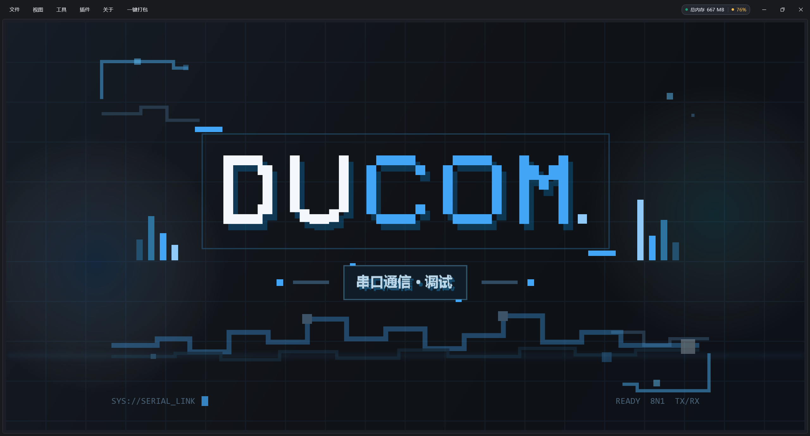
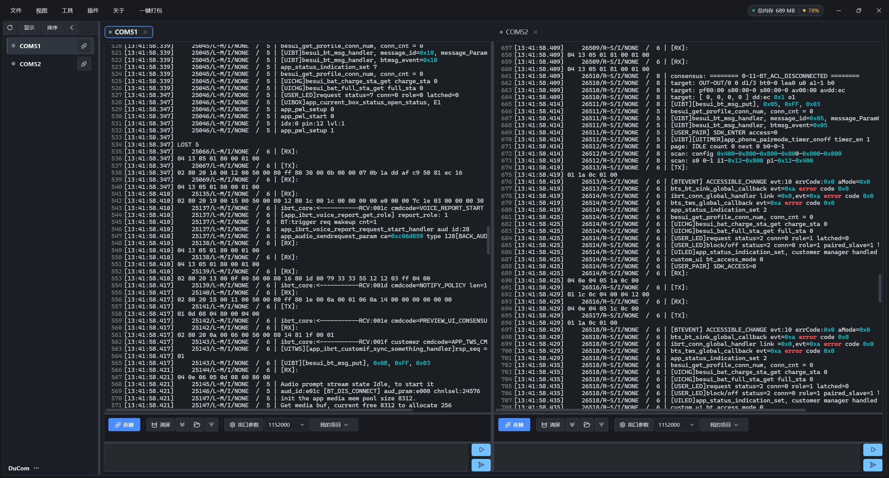
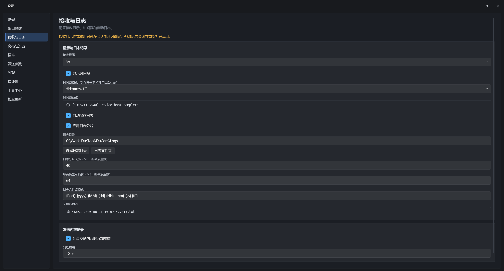
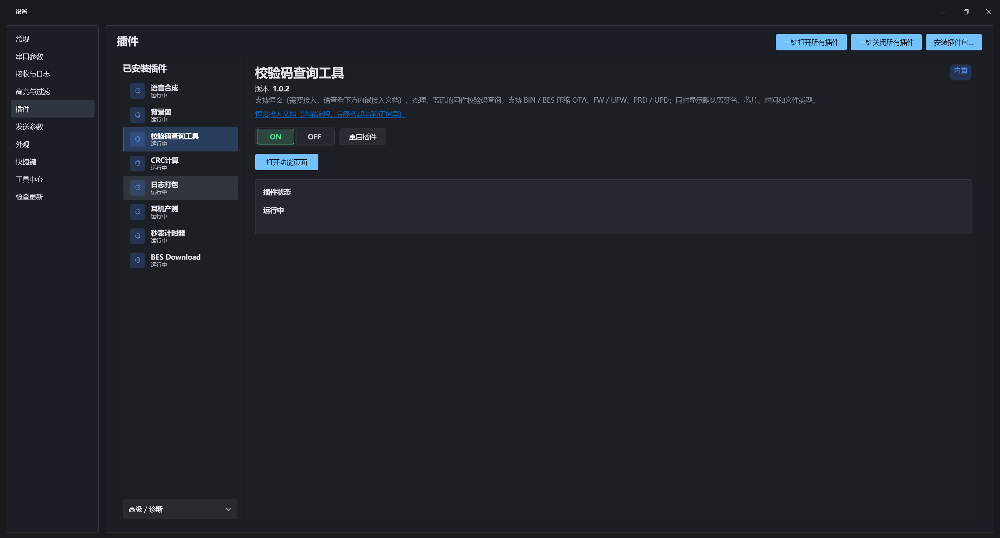
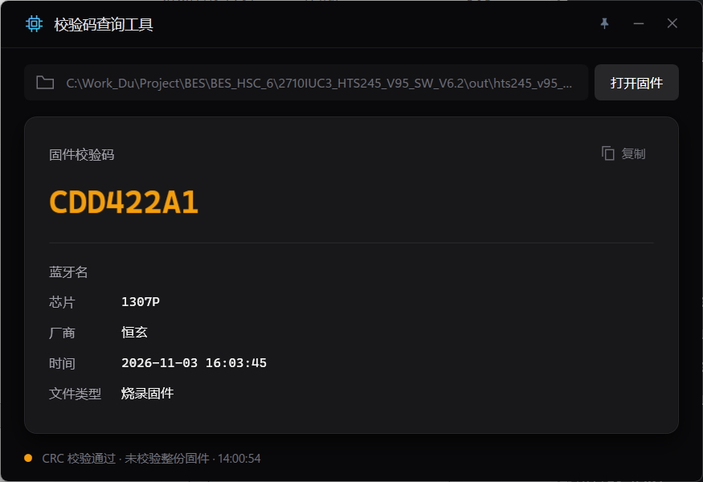
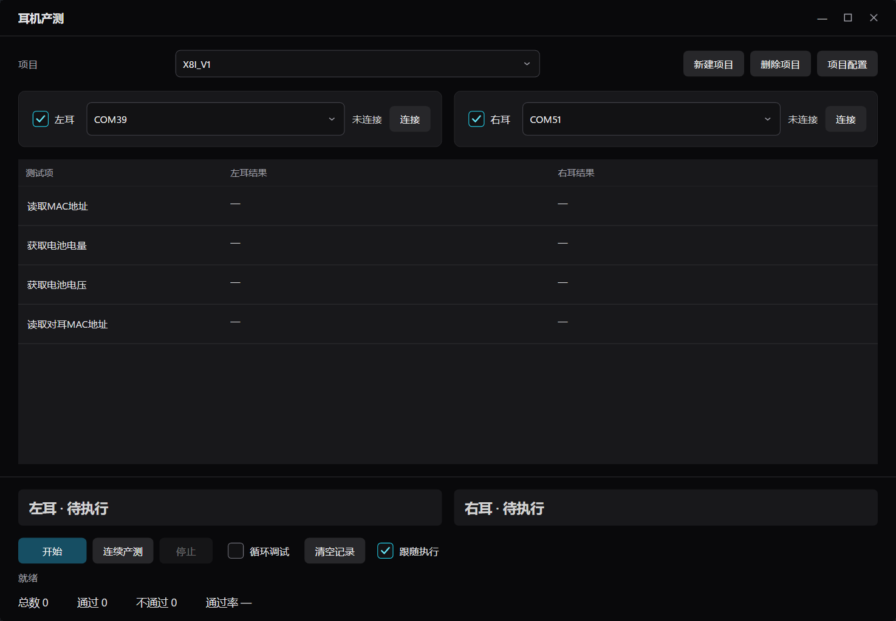
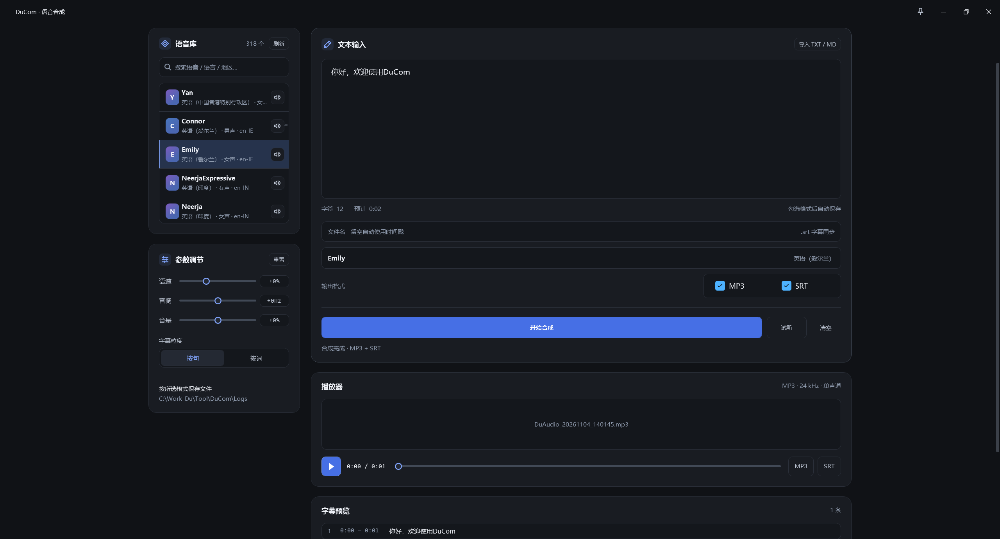
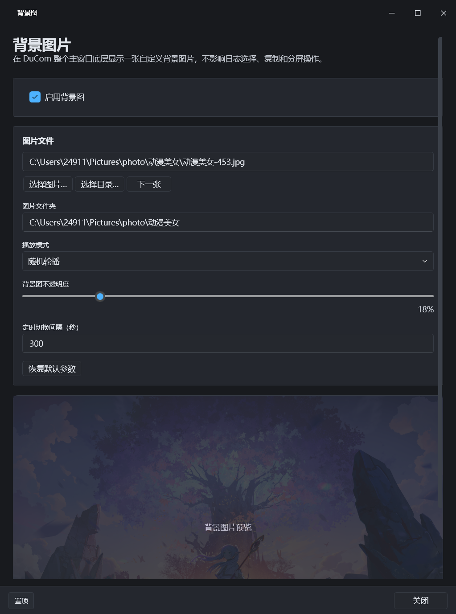
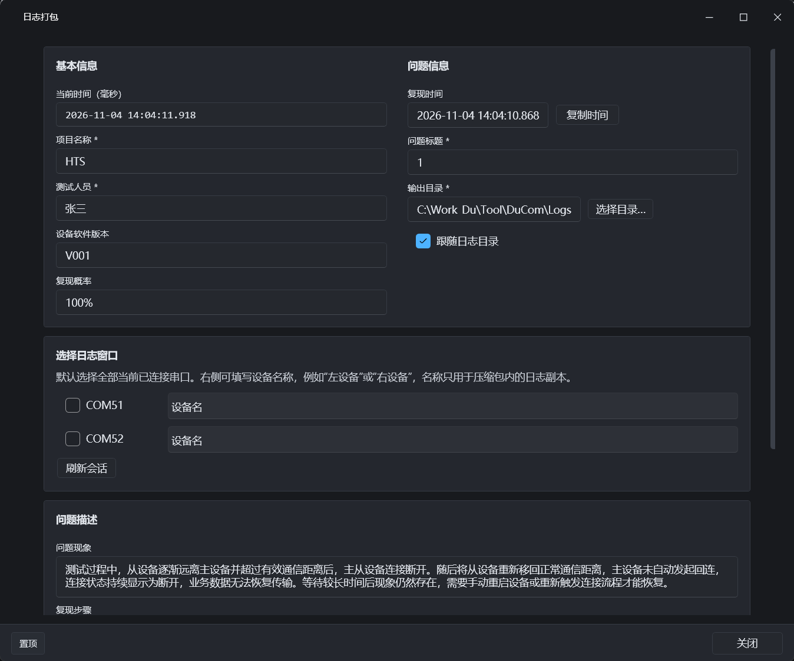
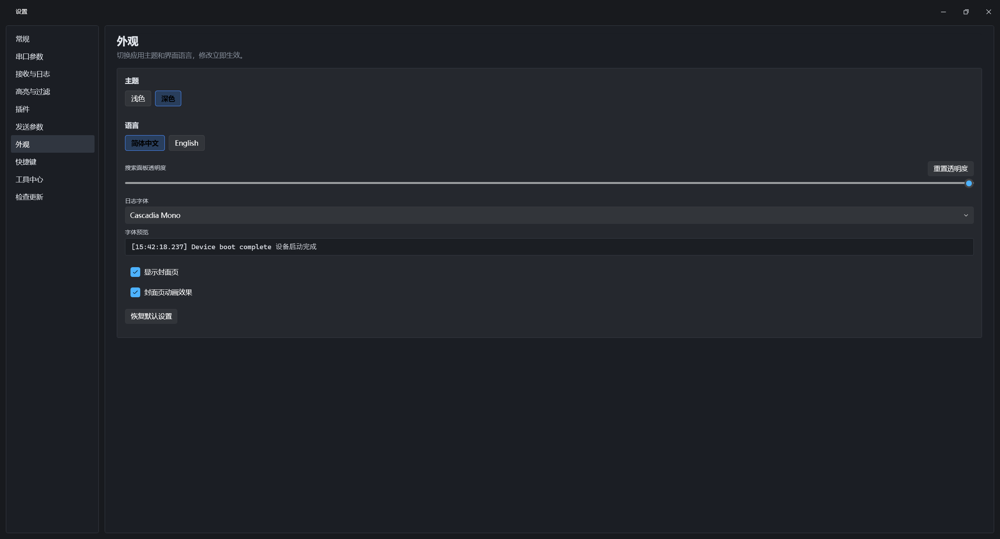

# DuCom

> 面向蓝牙音频开发的 Windows 串口工具。多串口、日志分析、命令组、耳机产测，都在一个程序里。


## 这是什么

DuCom 是 Windows 上的串口工具，主要给蓝牙音频固件和嵌入式开发用。

除了常规的串口收发，它把调试过程中反复做的几件事放在一起：多串口同时看、日志按规则高亮和落盘、常用命令编组批量执行、历史日志分析、问题现场打包。插件再补上固件校验码、CRC 计算、耳机产测、语音合成这些具体场景。

和通用串口助手相比，它更偏向长时间开着、日志量很大、还要和产线工具配合的用法。

## 能做什么

| 类别 | 能力 |
| --- | --- |
| 串口 | 多串口标签与分屏、自动重连、端口隐藏和排序、虚拟串口 |
| 显示 | STR/HEX、时间戳、ANSI/VT 渲染、行号、自动换行、控制字符可视化 |
| 日志 | 异步写盘、自动分片、显示预算、搜索、过滤、跟随与暂停 |
| 分析 | 日志分析器，支持实时会话和历史文件，解析 BES 与蓝牙事件 |
| 发送 | 发送历史、命令组、定时发送、转义解析、发送记录前缀、悬浮窗 |
| 工具 | 性能监控、虚拟串口、ASCII 表、Telnet、WatchDog、发送历史 |
| 插件 | DPP/1 协议、独立进程、菜单与工具页扩展、权限清单 |
| 更新 | 安装版、完整便携版、轻量版三套更新通道 |

## 界面

<p align="center">
  <br>
  <sub>启动封面，可在设置中关闭，或只关闭动画。</sub>
</p>

启动时会先显示封面页。觉得多余可以在设置里整个关掉，也可以保留静态画面、只关闭动画。

<p align="center">
  <br>
  <sub>两个串口并排：左边 COM51 看 BES 启动日志，右边 COM52 看 ACL 断开重连。</sub>
</p>

左侧是端口栏，中间是日志，底部是发送区。两个串口可以左右或上下分屏，各自独立配置、独立收发。会话多了用标签切换，也可以把常用端口固定在侧栏。

## 日志

<p align="center">
  <br>
  <sub>接收与日志设置，文件名格式下方有实时预览。</sub>
</p>

日志默认异步写盘，文件名支持 `{Port}`、`{yyyy}`、`{MM}`、`{dd}`、`{HH}` 这类占位符，可精确到毫秒；文件达到设定大小时自动分片。每个会话有 64 MB 显示预算，超出后从界面淘汰旧内容，磁盘日志不受影响。

高亮用正则匹配，内置 BES 常用的 Error、Warning、Status、Fault 模板，规则可以导入导出。过滤只影响显示，不影响接收和落盘。

### 日志分析器

日志分析器可以打开历史日志，也可以接实时会话。按时间、级别、模块、关键词筛选，规则可导入导出，结果能导出成表格。

BES 日志会额外解析启动流程、fault、蓝牙 HCI 和 Profile 事件，左侧分析树可以直接跳到对应段落。排查别人发来的日志时，不需要从头翻。

## 发送与命令组

发送区支持 STR/HEX、转义字符、自动换行、发送记录前缀、发送历史和定时发送。定时发送的最小间隔是 50 ms。

命令组把多条命令排好序，设置延时、超时和期望回复，运行时按顺序执行。目标端口可以多选，例如左右耳同时发送；每条命令显示发送中、等待回复、通过或超时。命令组支持导入导出，可以直接发给同事。

悬浮发送窗口置顶显示，可发送、接收和固定滚动，适合放在 IDE 旁边。

## 插件

<p align="center">
  <br>
  <sub>插件管理页，显示版本、能力、权限和运行状态。</sub>
</p>

插件按 DPP/1 协议开发，运行在独立进程中，崩溃不影响主程序收发。清单里声明能力和权限，设置里可以单独启停。

仓库内置七个插件：

| 插件 | 作用 |
| --- | --- |
| 固件校验码 | 读取杰理、蓝讯、恒玄固件的校验码和版本信息 |
| CRC 计算 | 21 种模型，支持 Hex/ASCII 输入和文件校验 |
| 语音合成 | 微软在线语音，导出 MP3 和 SRT |
| 耳机产测 | 左右耳双串口，按项目执行测试项 |
| 背景图 | 主窗口背景，支持文件夹轮播 |
| 日志打包 | 把问题现场整理成结构化压缩包 |
| 秒表 | 高精度计时，导出 CSV 和 Excel |

### 固件校验码

<p align="center">
  <br>
  <sub>拖入固件后可查看校验码、蓝牙名、芯片、厂商和编译时间。</sub>
</p>

杰理和蓝讯直接可用，恒玄需要按接入文档配置一次。接入说明在插件详情页，离线可看。

结果区会区分整份固件校验通过、CRC 校验通过、仅读到校验码和未识别到校验码，不会把“读到了信息”笼统当成校验通过。窗口支持置顶，方便对着烧录工具核对。

### 耳机产测

<p align="center">
  <br>
  <sub>左右耳各接一个串口，按项目执行测试项，结果显示通过或失败。</sub>
</p>

这是插件里最垂直的一个。左右耳各接一个串口，测试项在「项目配置」中定义：发送内容、期望回复、超时和回复解析方式。支持复合命令和左右耳数据引用，例如把左耳读到的 MAC 写给右耳。

每轮自动生成 `.log` 和 `.csv`，并统计通过率。项目配置是 JSON，可导入导出，换机型不用重新配。

### 语音合成

<p align="center">
  <br>
  <sub>在线语音库、文本输入、参数调节、试听和字幕预览。</sub>
</p>

用微软在线语音，内置 318 个音色。语速、音调、音量可以调，支持先试听再合成。

可以导入 TXT 和 MD，长文自动分块，界面显示合成进度。MP3 和 SRT 字幕可以分别导出。输出目录默认跟随日志目录，也可以指定。需要联网，代理默认跟随系统，也可单独配 HTTP 或 SOCKS5。

### 背景图

<p align="center">
  <br>
  <sub>背景图设置：图片文件夹、轮播间隔、透明度和缩放方式。</sub>
</p>

主窗口底层可以铺一张背景图，也可以指向一个文件夹随机轮播，透明度和切换间隔可调。

背景图不影响日志选择、复制、搜索和分屏操作。

### 日志打包

<p align="center">
  <br>
  <sub>填写项目、测试人员、版本、复现概率和问题描述，勾选要打包的串口。</sub>
</p>

填好项目、测试人员、设备软件版本、复现概率、设备名、问题描述和复现步骤，勾选要打包的串口，系统日志也可以一起带上。

生成的压缩包使用结构化目录，日志副本按设备名命名。别人拿到后可以直接按复现步骤试。

### CRC 计算

支持 Hex 和 ASCII 输入，也可以直接校验文件，文件上限 64 MiB。

内置 21 种常见模型，宽度、多项式、初值、异或值和输入输出反转都可以手动修改。结果可以复制成 Hex 或 Bin，按 `Ctrl+Enter` 计算，窗口支持置顶。

### 秒表

高精度计时，支持计次、暂停和继续。结果可以导出 CSV 或 Excel，用于测量时序和统计。

---

## 设计与实现

- **Core 层不依赖 WPF**，串口、管线、日志、存储、协议解析都在这一层，方便测试和复用
- **串口回调只做复制和入队**，解析、写盘和界面刷新都在别处
- **日志写盘与界面渲染分离**，磁盘慢不会阻塞接收
- **界面按固定节奏刷新**，不逐条渲染
- **显示存储有预算上限**，超长行自动分段
- **串口打开和关闭严格串行化**，避免端口状态竞态
- **插件在独立进程中运行**，通过清单声明能力和权限

## 外观与设置

<p align="center">
  <br>
  <sub>浅色/深色主题、中文/English、日志字体、搜索面板透明度，封面页也可关闭。</sub>
</p>

主题、语言和字体修改后立即生效。快捷键可以自定义，带冲突检测和恢复默认。配置定期自动备份，默认 7 天一次。

## 下载

[下载最新 Release](https://github.com/adu9527/DuCom/releases)

| 文件 | 适合什么情况 | 大小 |
| --- | --- | --- |
| `DuCom-win-Setup.exe` | 安装到本机，使用安装版更新通道 | 约 130 MB |
| `DuCom.exe` | 单文件免安装，自带 .NET 运行时，可放在 U 盘 | 约 79 MB |
| `DuCom-lite.exe` | 单文件免安装，使用系统已装的 .NET 10，体积最小 | 约 17 MB |

体积随版本浮动，以 Release 页面为准。三个包都支持应用内检查更新。

文档：[用户手册（中文）](Doc/UserManual.zh-CN.md) · [User Manual (English)](Doc/UserManual.en-US.md) · [开发者文档（中文）](Doc/DeveloperGuide.zh-CN.md) · [Developer Guide (English)](Doc/DeveloperGuide.en-US.md) · [插件协议 DPP/1（中文）](Doc/PluginProtocol.DPP1.zh-CN.md) · [Plugin Protocol DPP/1 (English)](Doc/PluginProtocol.DPP1.en-US.md) · [网页版文档入口](Doc/Web/index.html)

## 环境要求

- Windows 10 及以上
- .NET 10 SDK（只编译源码时需要）
- 推荐用 Visual Studio，WPF 的 XAML 编辑和调试体验更好

## 编译运行

```powershell
cd DuCom
dotnet build
dotnet run --project src\DuCom
```

跑测试：

```powershell
cd DuCom
dotnet test
```

## 打包发布

Visual Studio 里右键 `DuCom` 项目 → 发布。推荐设置：

| 配置项 | 建议值 |
| --- | --- |
| 配置 | Release |
| 目标运行时 | win-x64 |
| 部署模式 | Self-contained |
| 单文件输出 | 启用 |

发布产物作为 GitHub Release 上传，不要直接提交到仓库。

仓库也提供发布脚本：`scripts/publish-portable.ps1` 生成便携版，`scripts/publish-velopack.ps1` 生成安装包。

## 项目结构

```text
DuCom/
  src/DuCom/                          WPF 主程序：界面、ViewModel、依赖注入
  src/DuCom.Core/                     核心逻辑：串口、收发管线、日志、存储
  src/DuCom.Plugin.Sdk/               插件协议 SDK（DPP/1）
  src/DuCom.PluginHost/               插件宿主：生命周期、IPC 代理、资源管控
  src/DuCom.Plugins.Audio/            内置插件：语音合成
  src/DuCom.Plugins.BackgroundImage/  内置插件：背景图
  src/DuCom.Plugins.Checksum/         内置插件：固件校验码查询
  src/DuCom.Plugins.Crc/              内置插件：CRC 计算
  src/DuCom.Plugins.LogPackage/       内置插件：日志打包
  src/DuCom.Plugins.Production/       内置插件：耳机产测
  src/DuCom.Plugins.Timer/            内置插件：秒表
  profiles/                           耳机产测项目配置
  samples/                            插件示例，入门看 Example.HelloDuCom 的 README
  tools/DuCom.LoadGenerator/          压测工具，模拟高速串口输出
  tools/DuCom.SetupWizard/            安装向导
  tests/                              单元测试、插件测试、宿主恢复测试
  benchmarks/                         BenchmarkDotNet 性能基准
  docs/                               架构、设计、决策记录
  scripts/                            打包、发布、插件门禁脚本
```

## 分支与协作

| 分支 | 用途 | 谁来推 |
| --- | --- | --- |
| main | 稳定版本，Release 发布 | 作者（仅限作者推送） |
| test | 日常开发、功能迭代 | 作者（外部贡献者请提 PR 到此分支） |

个人开发者请 fork 后提 **PR 到 `test` 分支**，由作者审核合并。`main` 分支仅限作者推送并负责打 Release。

## 许可证

[GPL-3.0](LICENSE)，全文另见 [gnu.org](https://www.gnu.org/licenses/gpl-3.0.html)。

## 反馈

- QQ 群：`1107820408`
- [GitHub Issues](https://github.com/adu9527/DuCom/issues)
- 安全问题不要发公开 Issue，按 [SECURITY.md](SECURITY.md) 报告

## 参与

欢迎提 Issue 和 PR。几个小要求：

- Core 层和 Plugin.Sdk 保持零 UI 依赖
- 改了逻辑代码记得补测试
